# VolineUI

VolineUI is an Android UI component library by **5Degree**. It provides production-ready form controls, feedback components, image handling, and platform utilities with **two parallel APIs**:

- **View-based** — custom `View` subclasses usable from XML layouts and traditional Activities/Fragments
- **Jetpack Compose** — matching composables under `in.fivedegree.volineui.compose`

The companion `:app` module in this repository is a demo app with side-by-side View and Compose examples for every component.

## Installation

VolineUI is published on **Maven Central** as `io.github.5degree:volineui`. The transitive `:volinecore` module (Firebase, Room, offline queue, etc.) is pulled in automatically — you do not need to add it separately.

### Gradle (Kotlin DSL)

```kotlin
// app/build.gradle.kts
dependencies {
    implementation("io.github.5degree:volineui:3.0.0")
}
```

Maven Central is included by default in modern Android projects (AGP 7+), so no `repositories {}` changes are required.

### Gradle (Groovy)

```groovy
// app/build.gradle
dependencies {
    implementation 'io.github.5degree:volineui:3.0.0'
}
```

### Version catalog (`gradle/libs.versions.toml`)

```toml
[versions]
volineui = "3.0.0"

[libraries]
volineui = { module = "io.github.5degree:volineui", version.ref = "volineui" }
```

```kotlin
// app/build.gradle.kts
dependencies {
    implementation(libs.volineui)
}
```

### Requirements

| | |
|---|---|
| Min SDK | 24 |
| Compile SDK | 36 |
| JVM target | 17 |
| Kotlin | 2.0+ (Compose-enabled) |

## Screenshots

<table>
  <tr>
    <td align="center" width="33%"><strong>Button</strong></td>
    <td align="center" width="33%"><strong>Button (Variants)</strong></td>
    <td align="center" width="33%"><strong>Input Field</strong></td>
  </tr>
  <tr>
    <td>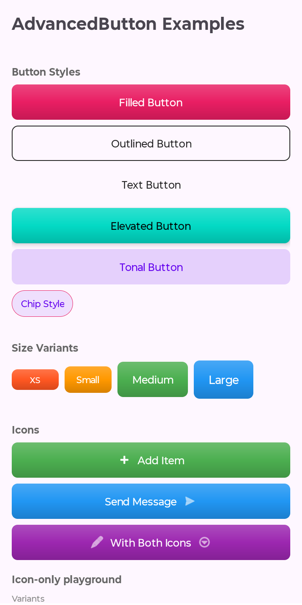</td>
    <td>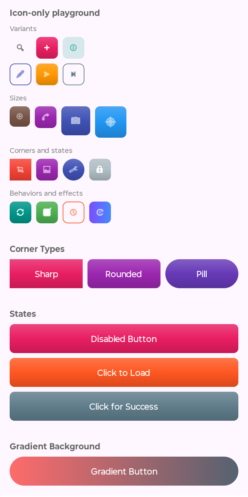</td>
    <td>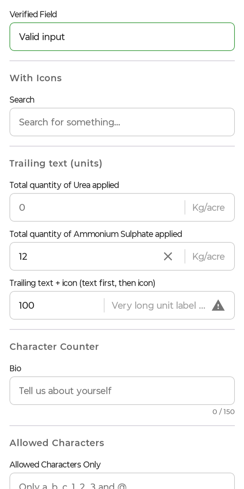</td>
  </tr>
  <tr>
    <td align="center" width="33%"><strong>Dropdown</strong></td>
    <td align="center" width="33%"><strong>Radio</strong></td>
    <td align="center" width="33%"><strong>Date Time Picker</strong></td>
  </tr>
  <tr>
    <td>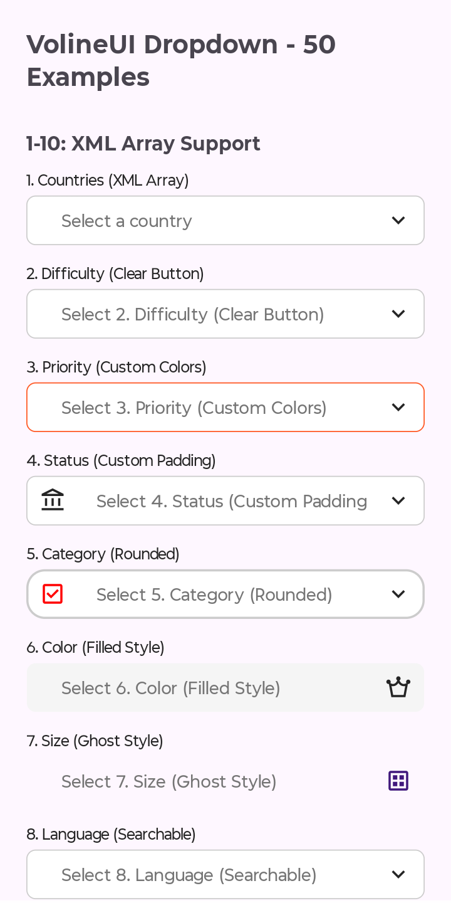</td>
    <td>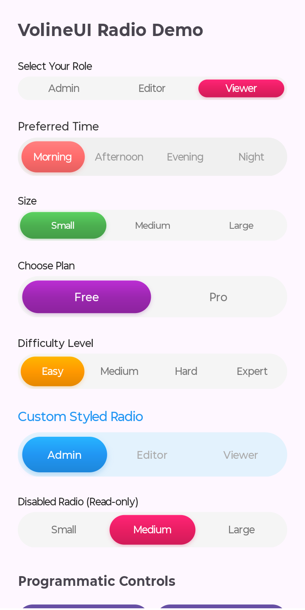</td>
    <td>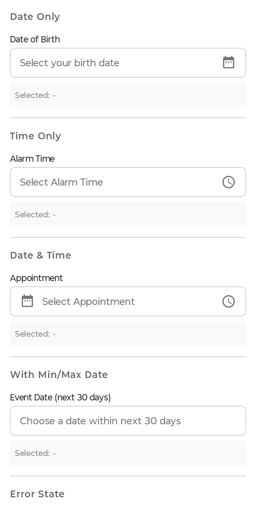</td>
  </tr>
  <tr>
    <td align="center" width="33%"><strong>Dialog</strong></td>
    <td align="center" width="33%"><strong>Toast</strong></td>
    <td align="center" width="33%"><strong>Image View</strong></td>
  </tr>
  <tr>
    <td>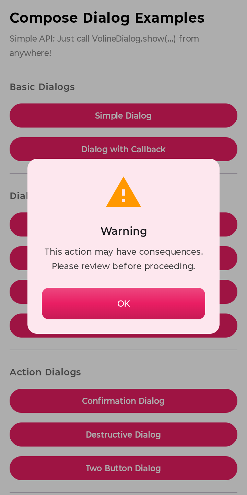</td>
    <td>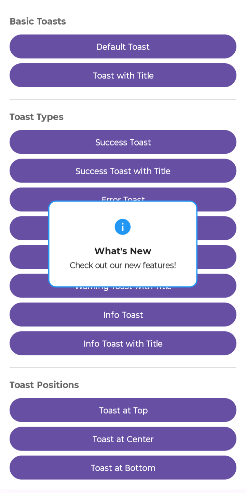</td>
    <td>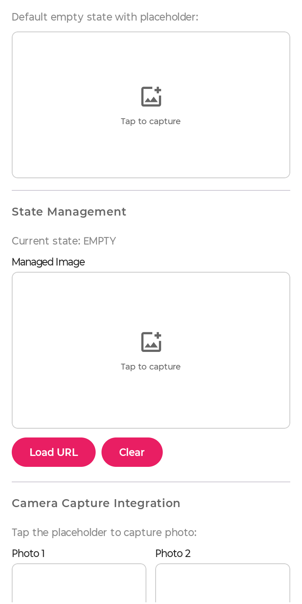</td>
  </tr>
  <tr>
    <td align="center" width="33%"><strong>Image View (Gallery)</strong></td>
    <td align="center" width="33%"><strong>Image View (Preview)</strong></td>
    <td align="center" width="33%"><strong>Image Carousel</strong></td>
  </tr>
  <tr>
    <td>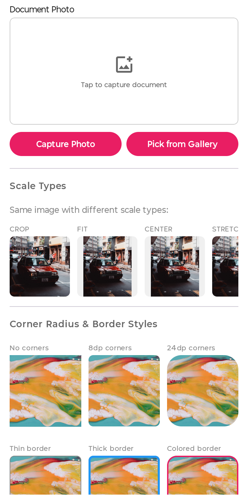</td>
    <td>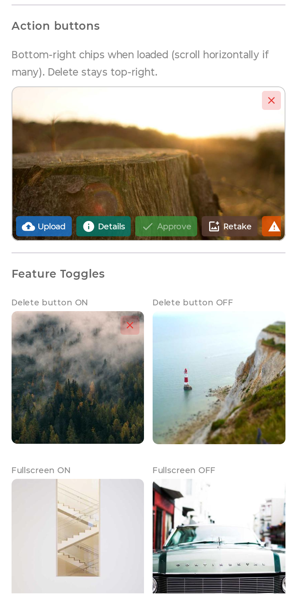</td>
    <td>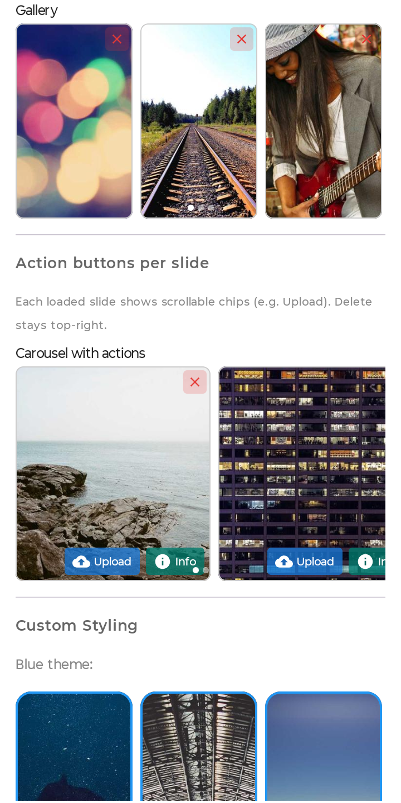</td>
  </tr>
</table>

## Quick start
### Initialize managers (Application)

`PermissionManager`, `LocationManager`, and `PhotoCaptureManager` are singletons that should be initialized once in your `Application` class:

```kotlin
class MyApp : Application() {
    override fun onCreate() {
        super.onCreate()

        PermissionManager.init(
            this,
            Manifest.permission.CAMERA,
            Manifest.permission.ACCESS_FINE_LOCATION,
            Manifest.permission.ACCESS_COARSE_LOCATION,
        )
        LocationManager.init(this)
        PhotoCaptureManager.init(this)
    }
}
```

Register the class in `AndroidManifest.xml`:

```xml
<application android:name=".MyApp" ... />
```

### Compose global overlays

For global toast and dialog helpers in Compose, add containers once at the root of your UI:

```kotlin
@Composable
fun MyApp() {
    MaterialTheme {
        VolineToast.Container()
        VolineDialog.Container()
        // ... rest of app
    }
}
```

Then show feedback from anywhere:

```kotlin
VolineToast.success("Saved!")
VolineDialog.confirm(
    title = "Delete?",
    message = "This cannot be undone.",
    onConfirm = { /* ... */ }
)
```

## Components

### UI controls

| Component | View (XML) | Compose | Notes |
|-----------|:----------:|:-------:|-------|
| AdvancedButton | ✓ | ✓ | Filled, outlined, text, FAB, chip, icon styles; loading/success/error states |
| InputField | ✓ | ✓ | Validation, masks, password toggle, trailing text, visual states |
| Dropdown | ✓ | ✓ | Single/multi select, search, chips, filtering |
| Radio | ✓ | ✓ | Segmented control with animated pill indicator |
| DateTimePicker | — | ✓ | Date, time, or date+time; styled like InputField |
| RulerValuePicker | ✓ | ✓ | Draggable ruler slider; horizontal/vertical, fling, snapping, labels, haptics |
| SignaturePad | ✓ | — | Drawing, undo/redo, export (PNG, JPG, SVG, Base64) |
| AdvancedImageView | ✓ | ✓ | URL/file/bitmap/URI/base64 sources; camera capture |
| ImageCarousel | ✓ | ✓ | Horizontal image list with indicators and full-screen preview |
| ActionButtonChip | — | ✓ | Compact action chip used by image components |

### Feedback

| Component | View | Compose |
|-----------|:----:|:-------:|
| VolineToast | ✓ (`VolineToast.show(activity, ...)`) | ✓ (`VolineToast.Container()` + static helpers) |
| VolineDialog | ✓ (`VolineDialog.show(context) { ... }`) | ✓ (`VolineDialog.Container()` + static helpers) |

Toast types: `DEFAULT`, `SUCCESS`, `ERROR`, `WARNING`, `INFO`.  
Dialog types: `DEFAULT`, `SUCCESS`, `ERROR`, `WARNING`, `INFO`, `CONFIRMATION`, `DESTRUCTIVE`.

### Platform managers

| Manager | Purpose |
|---------|---------|
| **PermissionManager** | Request/check permissions with callbacks; handles permanent denial and settings redirect |
| **LocationManager** | Cached, one-shot, and streaming location via Fused Location Provider |
| **PhotoCaptureManager** | Camera capture and gallery picker with compression, watermark, and GPS stamping |

`LocationManager` and `PhotoCaptureManager` integrate with `PermissionManager` automatically.

## Usage examples

### View — InputField (XML)

```xml
<in.fivedegree.volineui.InputField
    android:layout_width="match_parent"
    android:layout_height="wrap_content"
    android:hint="Email address"
    app:label="Email"
    app:validationType="email"
    app:enableValidation="true"
    app:showClearIcon="true" />
```

Supported validation types: `none`, `email`, `phone`, `url`, `custom` (with `customValidationPattern`). Input masks use `#` as the placeholder character (e.g. `(###) ###-####`).

### View — VolineDialog

```kotlin
VolineDialog.show(context) {
    title = "Confirm Action"
    message = "Are you sure you want to proceed?"
    type = DialogType.CONFIRMATION
    primaryButtonText = "Confirm"
    secondaryButtonText = "Cancel"
    onPrimaryClick = { /* handle */ }
}
```

### Compose — InputField

```kotlin
var text by remember { mutableStateOf("") }

InputField(
    value = text,
    onValueChange = { text = it },
    label = "Email",
    hint = "Enter your email",
    validationType = ValidationType.EMAIL,
    showClearIcon = true,
)
```

### Compose — Dropdown

```kotlin
val options = listOf(
    DropdownOption(id = "1", label = "Option A"),
    DropdownOption(id = "2", label = "Option B"),
)

Dropdown(
    options = options,
    label = "Choose one",
    selectionMode = DropdownSelectionMode.SINGLE,
    onSelectionChanged = { selected -> /* ... */ },
)
```

### View — RulerValuePicker (XML)

```xml
<in.fivedegree.volineui.RulerValuePicker
    android:id="@+id/ruler"
    android:layout_width="match_parent"
    android:layout_height="wrap_content"
    app:rulerMinValue="150"
    app:rulerMaxValue="210"
    app:rulerStep="1"
    app:rulerMajorStep="10"
    app:rulerValue="160"
    app:rulerUnit="cm" />
```

```kotlin
ruler.setOnValueChangeFinishedListener { value ->
    // value is snapped and clamped
}
```

### Compose — RulerValuePicker

```kotlin
val state = rememberRulerValuePickerState(
    minValue = 150.0,
    maxValue = 210.0,
    step = 1.0,
    majorStep = 10.0,
    initialValue = 160.0,
    unit = "cm",
)

RulerValuePicker(
    state = state,
    modifier = Modifier
        .fillMaxWidth()
        .height(120.dp),
    tickShape = RulerTickShape.ROUNDED_LINE,
)
```

### Photo capture with watermark

```kotlin
val config = PhotoCaptureConfig(
    watermarkText = "Field Survey",
    printFreshLatLng = false,
    targetFileSizeKB = 200,
)

PhotoCaptureManager.instance.capturePhoto(config) { result ->
    when (result) {
        is PhotoCaptureResult.Success -> { /* use result.file / result.bitmap */ }
        is PhotoCaptureResult.Error -> { /* handle error */ }
        is PhotoCaptureResult.Cancelled -> { /* user cancelled */ }
    }
}
```

Photo capture opens VolineUI's own in-app camera screen (CameraX) — it does
not launch a system camera app, and there is no fallback to one: if the
in-app camera cannot start, `capturePhoto` reports an `Error`. The camera
screen inherits the host app's Material theme for its controls, and offers
a preview sized to the selected aspect ratio, back camera and flash off
by default, flash, tap-to-focus, pinch-to-zoom, an iPhone-style ruler
zoom control whose range comes from the camera itself (swipe left to
zoom in, right to zoom out), and a Retake / Use photo review step
with text buttons. The aspect ratio and the front camera are
host-driven through `PhotoCaptureConfig`: `aspectRatio` defaults to
a locked 4:3 (the aspect pill is hidden, so the user cannot change
it); `AspectRatio.NONE` shows the pill and lets the user switch
4:3 / 16:9 for that capture only, nothing is remembered; and
`allowFrontCamera` (default false) hides the switch-camera button
and keeps the capture on the back camera, while true shows the
button on devices that have a front camera. The review image is rotated
by the photo's EXIF orientation, so it matches the returned photo.
Front-camera photos are saved as captured (not mirrored to match the
preview).

### Capture guides (photo capture)

A host that wants a guided capture sets `captureGuide` in the config
(default `NONE`, today's behaviour). `PERSON` draws a person-shaped
outline over the live preview with a dimmed surround: the outline is
green and the shutter enabled while a person is framed inside it, red
and the shutter disabled otherwise (live selfie segmentation, ML Kit,
on-device, no network). After the user taps Use photo, face-mesh
detection runs on the finished photo and the result carries it in
addition to everything else: `Success.faceMesh` holds 468 points,
a bounding box, and the triangle indices between the points, in the
delivered photo's pixel space, as plain data the host can send to a
server as JSON. Joining each triangle's three points draws the full
wireframe; the points alone draw dots. If no usable face is found,
the photo is still returned with an empty mesh — that never fails
the capture. `DOCUMENT` launches Google's document-scanner UI instead
of this camera screen (single page, gallery import off, full cleaning:
crop, filters, shadow and stain removal); the cleaned page comes back
into the confirmation screen, then the OCR step if fields were given,
and the cleaned image is the returned photo. Note the scanner is
Play-services-based, unlike the bundled segmentation and face-mesh
models: it downloads on first use and cannot work on devices without
Play services, where it reports an Error. Both ML Kit guide models
are still beta, and add roughly 4.5 MB (segmentation) and 6.4 MB
(face mesh) to the app.

```kotlin
val personConfig = PhotoCaptureConfig(captureGuide = CaptureGuide.PERSON)
val documentConfig = PhotoCaptureConfig(captureGuide = CaptureGuide.DOCUMENT)
PhotoCaptureManager.instance.capturePhoto(personConfig) { result ->
    if (result is PhotoCaptureResult.Success) {
        println(result.faceMesh) // 468 points + box + triangles, or empty when no face
    }
}
```

### Document OCR (photo capture)

A host that wants data read off a document photo passes the fields it
wants in the capture config. After the user confirms the photo, an OCR
step runs on-device (ML Kit, Latin + Devanagari, no network, so the
photo never leaves the device) and the user picks a field, then taps
its words on the photo — pinch-zoom and pan included — for each field.
Tapping a word of the active field removes it, tapping a word of
another field moves it, and a field's value is its words in tap order.
Nothing can be typed by hand. Done is disabled until every required
field has a value; optional fields left empty are absent from the
result. The photo itself goes through the unchanged pipeline
(watermark, compression, gallery save) and comes back together with
the collected values. The same OCR step opens for gallery picks.

```kotlin
val config = PhotoCaptureConfig(
    ocrFields = listOf(
        OcrField("personName", "Person Name", required = true),
        OcrField("dob", "Date of Birth", required = true),
        OcrField("gender", "Gender", required = false),
        OcrField("documentNumber", "Document Number", required = true)
    )
)
PhotoCaptureManager.instance.capturePhoto(config) { result ->
    if (result is PhotoCaptureResult.Success) {
        println(result.ocrData) // e.g. {personName=..., dob=..., documentNumber=...}
    }
}
```

If recognition fails or finds no text, the user is offered Retry scan,
Continue with photo only (empty OCR data), and Retake (camera) or
Cancel (gallery). Back from the OCR step returns to the photo
confirmation screen; in the gallery flow it cancels.

### Location

```kotlin
// Instant cached location
LocationManager.instance.getCachedLocation { location ->
    location?.let { println(it.coordinatesString) }
}

// Stream updates every 5 seconds
val id = LocationManager.instance.startLocationUpdates(5000L) { location ->
    println(location.coordinatesString)
}
LocationManager.instance.stopLocationUpdates(id)
```

### Permissions

```kotlin
PermissionManager.instance.requestPermission(Manifest.permission.CAMERA) { result ->
    if (result.isGranted) {
        openCamera()
    } else if (result.isPermanentlyDenied) {
        PermissionManager.instance.openAppSettings()
    }
}
```

## Package structure

```
in.fivedegree.volineui
├── AdvancedButton, InputField, Dropdown, Radio, SignaturePad
├── AdvancedImageView, ImageCarousel
├── RulerValuePicker
├── VolineDialog, VolineToast
├── PermissionManager, LocationManager, PhotoCaptureManager
├── button/          — shared button enums and defaults
├── camera/          — in-app CameraX camera activity and screen
├── compose/         — Jetpack Compose equivalents
├── dialog/          — dialog types and defaults
├── dropdown/        — options, filters, state
├── imageview/       — image sources, filters, full-screen viewer
├── inputfield/      — validation, masks, colors
├── locationmanager/ — location result types
├── permissionmanager/
├── photocapturemanager/
├── radio/
├── ruler/           — scale, enums, colors, dimensions
├── signaturepad/
└── toast/
```

## Permissions

The library manifest declares permissions used by camera, location, and network features. Merge these into your app and request runtime permissions as needed:

- `CAMERA`
- `ACCESS_FINE_LOCATION` / `ACCESS_COARSE_LOCATION`
- `INTERNET`
- `VIBRATE` (haptic feedback on buttons)

No `FileProvider` setup is needed for camera capture anymore: the in-app
camera writes directly to a file created by `PhotoCaptureManager`. (A
`FileProvider` in a host app is harmless, but it is no longer on the
capture path.)

## Dependencies

VolineUI pulls in:

- AndroidX Core, AppCompat, Material
- Jetpack Compose (Material 3)
- Google Play Services Location
- AndroidX ExifInterface
- Glide (View image loading)
- Coil 3 (Compose image loading, GIF, network)
- CameraX 1.6.2 (in-app camera: core, camera2, lifecycle, view)

## Theming

View components read colors from your app theme (e.g. `colorPrimary` for dialog/toast accents). Compose components accept explicit color parameters via `*Defaults` and `*Colors` objects (e.g. `InputFieldDefaults`, `DropdownDefaults`, `RadioDefaults`).

## Demo app

Run the `:app` module to explore all components. `MainActivity` links to View-based and Compose example screens for buttons, inputs, dropdowns, radios, dialogs, toasts, image views, carousels, date/time pickers, ruler pickers, signature pad, permissions, location, and photo capture.

## License

Apache License 2.0
